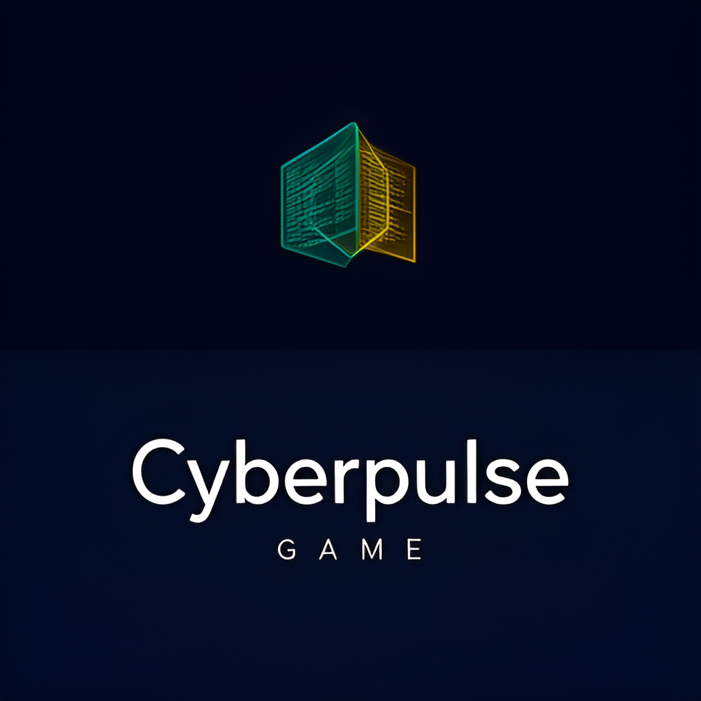
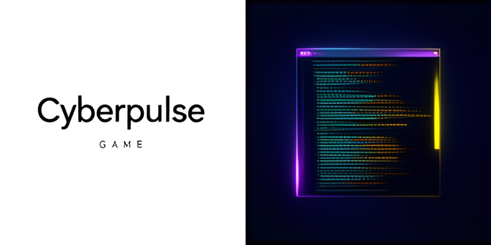
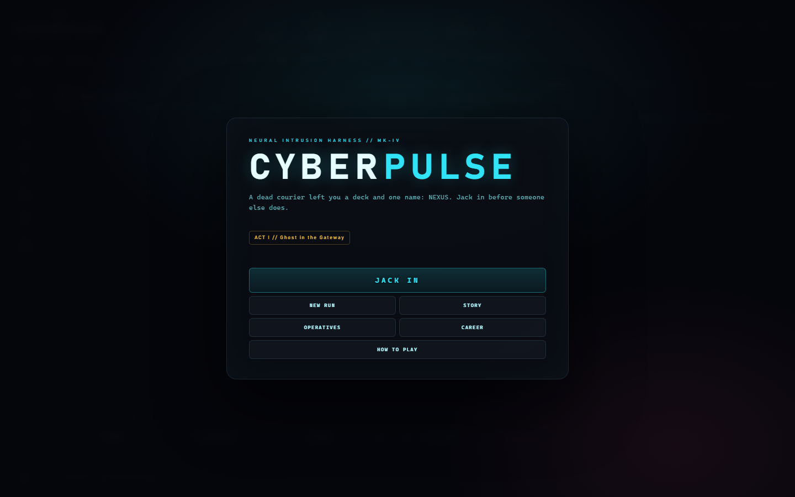

# cyberpulse

<!-- aegean:media:start -->
<p align="center"></p>
<p align="center"></p>
<!-- aegean:media:end -->

[](https://github.com/AegeanWorks/AIKit)

CyberPulse is a retro-cyberpunk terminal hacking simulation game designed around empirical behavioral psychology: procedural puzzle nodes, ICE defenses, push-your-luck extraction, persistent career progression and a five-act story campaign, played in the terminal or the Web Cyberdeck.

It also features variable-ratio reward schedules, near-miss striatal feedback, an operative relationship system, a dynamic quest board, combo/overdrive risk-reward mechanics, and a living-grid world simulation with an in-game clock, corporate alert, generated news, ambient events, host re-securing, a drifting black market, tactical shifts, lay-low downtime, and a deadline-bound Syndicate contract market.

## ⚡ 30-Second Cold-Start Quick Reference

- **Runtime Prerequisites**: Python 3.10+ (standard library only; zero third-party packages required); a modern browser for the Web Cyberdeck.
- **Canonical Regression Shield Gate**:
  ```bash
  python aikit.py check cyberpulse
  ```

### 🚀 Instant One-Click Launch (Zero-Friction)
From inside the `projects/cyberpulse` directory:
- **Windows**: Double-click `start.bat` (or run `start.bat` in CMD / PowerShell)
- **Universal**: Run `python start.py` (or `./start.sh` on POSIX / macOS / Linux)
*(Defaults to launching the visual Web Cyberdeck; custom flags like `python start.py --seed 1337` are forwarded directly to the CLI)*

### 🛠️ AIKit Commands (run from the AIKit folder)
| Role | Command |
|---|---|
| Status, task and gates | `python aikit.py status cyberpulse` |
| Phase 4: every gate | `python aikit.py check cyberpulse` |
| Repair memory and map, then check | `python aikit.py fix cyberpulse` |
| Resume an interrupted task | `python aikit.py resume cyberpulse` |

## 📦 What's Inside

```text
cyberpulse/
├── .aikit/                   <- this project's memory: record, ledger, decisions
├── .gitignore                <- transient AIKit state excluded
├── LICENSE                   <- Aegean Game License 1.1 (AGL-1.1): DRM-free personal play
├── LICENSES/                 <- REUSE license texts
├── REUSE.toml                <- Machine-readable SPDX metadata
├── ASSETS.md                 <- Asset/data manifest: what the license covers
├── README.md
├── COMMANDS.md  <- in-game command reference
├── COMMERCIAL.md
├── pyproject.toml            <- build and package configuration
├── start.bat                 <- Windows one-click launcher
├── start.py                  <- universal launcher (defaults to --web)
├── start.sh                  <- POSIX / Linux / macOS launcher
├── cyberpulse/               <- core game engine and CLI
│   ├── __init__.py
│   ├── cli.py                <- interactive terminal interface & REPL
│   ├── engine.py             <- deterministic game state coordinator
│   ├── models.py             <- frozen dataclasses & domain state models
│   ├── network.py            <- procedural network grid generator
│   ├── puzzles.py            <- cyber-intrusion puzzle nodes & near-miss detection
│   ├── rewards.py            <- variable-ratio loot tables & reward schedules
│   ├── server.py             <- zero-dependency HTTP REST & cyberdeck server
│   ├── shop.py               <- black market tech vendor & hardware catalog
│   ├── story.py              <- story acts, quest blueprints, operative dialogue
│   ├── static/               <- Web Cyberdeck UI (HTML, CSS, JS)
│   │   ├── app.js
│   │   ├── index.html
│   │   └── style.css
│   ├── world.py              <- living-grid clock, alert, news, ambient events
│   └── storage.py            <- atomic persistence & career dossier management
└── tests/                    <- unit & integration test suite (about a second)
    ├── __init__.py
    ├── test_cli.py
    ├── test_engine.py
    ├── test_grid.py
    ├── test_init.py
    ├── test_models.py
    ├── test_network.py
    ├── test_puzzles.py
    ├── test_rewards.py
    ├── test_server.py
    ├── test_shop.py
    ├── test_storage.py
    └── test_world.py
```

## 🧠 Behavioral Psychology & Engagement Mechanics

CyberPulse's mechanics are grounded in cognitive neuroscience and behavioral game design:

1. **Variable Ratio Reinforcement Schedules (Skinner / Schultz Dopamine Reward Prediction Error)**:
   - Node breach rewards utilize randomized reward schedules (70% standard yield, 20% high-yield 2.5x jackpot, 10% rare hardware chip).
   - Unpredictable payoff magnitude induces striatal dopamine bursts, maximizing engagement compared to fixed rewards.
2. **Near-Miss Effect & Striatal Dopamine Response (Clark et al., 2009)**:
   - Narrow failures (frequency inside the harmonic band, keyword within 1 letter, first buffer block aligned) trigger explicit near-miss sensory feedback.
   - The first near miss on each puzzle becomes a **NEAR-MISS SURGE**: one bonus tuning/keyword attempt, or one free buffer retry. Later near misses are flavor only, so the comeback is real but cannot be farmed.
   - Neuroimaging proves near-misses activate the same reward pathways (nucleus accumbens and anterior insula) as wins, driving re-engagement and persistent play.
3. **Push-Your-Luck & Loss Aversion (Kahneman & Tversky Prospect Theory)**:
   - Breached credits remain *unbanked* during an active run. Reaching 100% ICE trace triggers Burnout Lockout, destroying all unbanked bounty.
   - `jackout` applies a **Black ICE extraction surge** (+5% at 50% trace, +10% at 70%, +15% at 85%, mitigated by the ICE dampener). A projected 100% burns the run at the extraction point, so disciplined banking matters as much as deep intrusion.
4. **Zeigarnik Effect (Incomplete Contract Tension)**:
   - Active Syndicate Bounty Contracts track unfulfilled goals (e.g. breach 2 encryption nodes). Unfinished objectives create cognitive tension that motivates session continuation.
5. **Autonomy & Competence Loop (Ryan & Deci Self-Determination Theory - PENS)**:
   - Tactical agency through branching network topologies, upgrade pathways, and cyberdeck customization in the Black Market vendor.
6. **Deadline Pressure & Goal Gradient (Kivetz et al.)**:
   - Each job carries a visible deadline and rush bonus, so `lay_low`, detours, and loud play spend a finite reward window. Completed work raises giver trust and payout; a missed deadline costs both and raises alert.
6. **Combo Streaks & Voluntary Risk (Sensation Seeking / Flow Channel)**:
   - Consecutive successful breaches build a reward multiplier (up to +50%). `overdrive` lets the player voluntarily burn CPU and trace to prime the next combo, tightening the flow channel between boredom and lockout. Any detected failure (burned puzzle, flagged social lure, hunter clash, antivirus quarantine) breaks the streak, so the multiplier is a real stake rather than a ratchet. A burned puzzle also seals its host's ICE for two turns, so failure costs tempo instead of granting a free retry. Best combo is recorded in the career dossier, and combo milestones appear in the run epilogue.
7. **Narrative Transportation & Character Attachment**:
   - Five story acts, a mission board, and four persistent operatives turn abstract objectives into relationships. Act progression unlocks new dialogue, jobs, and one-time favors that materially change the run, while trust tracks your standing with each operative.
8. **Implementation Intentions (Gollwitzer)**:
   - Accepted quests and the story objective card make the next concrete action salient, reducing choice paralysis while preserving player autonomy.
9. **Meaningful Narrative Choice (Self-Concordance)**:
   - In Act III, Agent Zero offers a one-time alliance or defiance decision. The choice changes trust, rewards, late-act dialogue, and the run epilogue, making the relationship feel authored rather than cosmetic.
10. **Diegetic Feedback & Situational Awareness (Presence)**:
   - The living grid runs its own clock, alert level, market, and news wire. Loud play raises alert, which raises patrol trace, re-secures breached hosts, and marks up the black market, while generated headlines report the consequences. The world reacts and narrates, so choices feel embedded in a place rather than a menu.

## 🎮 How to Play

### 1. Web Cyberdeck (Visual CRT & Web Audio)
Launch the browser cyberdeck: main menu, story/mission board, operative channels, interactive 2D node matrix, tactical stance/proxy dock, visual mini-games, a living-grid ticker (clock, alert, market, headlines), and synthesized 8-bit FX:

```bash
# Launch interactive Web Cyberdeck (auto-opens browser at http://127.0.0.1:8420)
python -m cyberpulse.cli --web

# Launch with custom world seed and port
python -m cyberpulse.cli --web --port 9000 --seed 42069
```

### 2. Interactive Terminal CLI
Or operate purely in the retro terminal REPL harness. Both interfaces open with a main menu for a new run, story briefing, operative channels, career dossier, and help; the terminal also offers save continuation:

```bash
# Launch interactive terminal game with default seed
python -m cyberpulse.cli

# Launch terminal game with custom world seed
python -m cyberpulse.cli --seed 42069
```

### In-Game Commands (Authentic Simulation & Tactical Netrunning)

The full reference of 43 commands, with each one's action and simulation role, is in [COMMANDS.md](COMMANDS.md).

### 🕹️ Authentic Cyber Warfare Infiltration Workflow
1. **Network Reconnaissance**: Discover network topology with `scan` or read host configuration files with `cat /etc/hosts`. Scan active network ports using `probe 192.168.1.10`.
2. **Perimeter Firewall Inspection & Ingress Bypass**: Check host firewall with `firewall 192.168.1.20`. If port 22 is blocked, craft a port-knocking sequence or packet fragmentation with `bypass 192.168.1.20 22 knock` to deactivate the rule!
3. **Multi-Vector Social Engineering**: Exploit the human factor with `social 192.168.1.10 pretext "Sarah Chen"` or `social 192.168.1.10 vishing`. Compromised staff leak authentication tokens, downgrade node security level, and override blocked firewall rules!
4. **Endpoint Antivirus Evasion**: Inspect endpoint protection with `av 192.168.1.10`. If SentinelCore or DefenderBasic alert levels rise, deploy a kernel hook via `evade 192.168.1.10 rootkit` to blind heuristic sweeps and protect active daemons.
5. **Weaponized CVE Exploits**: Consult your exploit repertoire with `cve`. Launch zero-days matching target services via `exploit 192.168.1.10 21 CVE-2011-2523` or `exploit 192.168.1.20 22 CVE-2024-6387`.
6. **Deploy Persistent Malware**: Plant passive listeners with `keylogger 192.168.1.10` to siphon crypto credits every turn. Unevaded AV will actively hunt daemons unless blinded.
7. **Exfiltrate High-Value Data**: Traverse directories with `ls`, inspect files with `cat`, and extract proprietary databases with `steal /data/corporate_slush_fund.csv`. Stolen data archives straight into your local rig at `/loot/`!
8. **Sanitize & Cash Out**: Scrub audit records with `wipe_logs` to shed ICE trace, then extract via `cash_out` before trace reaches 85% — the Black ICE extraction surge can burn the run at the jack. Banking early locks in bounty and grows your career dossier!
9. **Live With the Grid**: Watch `world` and `news` between jobs. A hot alert invites NetWatch patrol trace, black-market markups, and sysadmins re-securing the hosts you left behind (with any daemons inside), while a quiet grid cools down and discounts gear.
10. **Choose and Beat the Job Clock**: `contract` shows the offer board; `accept_job <id>` starts the clock. Early completion pays the rush bonus and raises trust; a missed deadline costs trust, raises alert, and refreshes the board.

## 🛡️ Architecture & Guarantees

- **Zero Undeclared Dependencies**: Built with 100% pure Python standard library modules (`random`, `json`, `dataclasses`, `pathlib`, `argparse`).
- **Deterministic State Engine**: Every network grid and puzzle sequence can be reproduced using `--seed <int>`.
- **Power-Loss Safe Savegames & Shadow Backup**: Uses atomic temporary file writes, `fsync`, `.bak` shadow recovery, and corruption quarantine to eliminate state loss risk.
- **Deterministic Save Integrity**: The reward RNG state and in-progress puzzle attempts/near-miss state are persisted, so save/load continues the exact seeded sequence instead of rerolling rewards or resetting attempts. Legacy saves without these fields fall back to the prior reseed behavior.
- **Deterministic Run Settlement**: Victory and `jackout` both bank all unbanked loot; trace lockout records a failed run. CLI and Web Cyberdeck share the same one-shot career lifecycle, so rewards are never double-counted or silently lost.
- **Persistent Puzzle Attempts & Consequential Failure**: Reopening a node resumes its remaining attempts, including across save/load, instead of granting a free retry. A fully burned script adds escalating trace, breaks the combo, raises host EDR alert, and seals the host for two turns (`HOST LOCKDOWN`), so the next attempt must wait for the grid to move or target another host.
- **Story, Quests & Operatives Persist**: Story act, log, quest progress, contact trust, and spent favors are stored in the savegame and backfilled for pre-story saves.
- **Run Legacy & Epilogues**: Victory, jackout, and lockout produce a run summary with quest/contact progress, best combo, and a story epilogue shown in both CLI and Web. Career dossiers record the highest combo across runs.
- **Branching Alliance**: The Act III Agent Zero choice is persisted in the savegame and changes trust, rewards, dialogue, and the epilogue; old saves default to no choice.
- **Same-Origin Web Cyberdeck**: The REST API sends no wildcard CORS grant and serializes state mutations, keeping the local game session private to its own page.
- **Dynamic Resource Loop**: Turn-based CPU cooling (+1/turn) and hardware RAM constraints (`security_level * 16` MB).
- **Living Grid Simulation**: Every turn advances a 15-minute in-game clock, drifts the black-market index (0.80x-1.35x, applied to shop prices and to the fence payout of stolen data), and cools or sustains the corporate alert level from your current trace.
- **Living Syndicate Contract Market**: Three rotating offers name a host/objective (`breach`, `extract`, `wipe`) with standard/priority/black risk, scaled pay and trace limits, an acceptance deadline, and a rush window. Exhausted grids post repeatable recon sweeps. Giver trust improves terms; missed deadlines cost trust and raise alert.
- **Reactive Corporate Response**: Alert 50%+ enables NetWatch patrol trace and sysadmin re-securing of breached hosts (12-turn cooldown, one host per turn, never your current host or the Nexus core); re-secured hosts restore their defenses and quarantine embedded daemons.
- **Corporate Posture Escalation**: The grid reports named postures (GREEN/AMBER/RED/BLACK). Breached hosts slow alert decay by up to 3/turn, and posture transitions post news bulletins reflecting city escalation.
- **Anti-Farm Breach Ledger**: A re-secured host pays no second reward, combo, or quest credit, so grid healing cannot be farmed for infinite credits.
- **Deterministic World Events**: Ambient events, headlines, and re-secure rolls use a per-tick RNG stream from `(seed, tick, stream)` for reproducible gameplay outcomes.
- **Backward-Compatible World State**: Old saves without a world clock load with a fresh Day 1 world; the new fields are additive and atomic with the existing savegame.
- **NetWatch Active Hunters & Pursuit Simulation**: Alert 60%+ mobilizes autonomous ICE hunters that track player location across network graph hops, trigger connection clashes on interception (+15% trace, -2 CPU), quarantine unmonitored daemons, and react to scent scrambling (`spoof`/`wipe_logs`) and countermeasures (`logic_bomb`/`ghost_protocol`). Only one hunter can hold the sector at a time; an intercepted hunter still counts as active, preventing a second clamp from stacking onto the first.
- **Tactical Shift Dynamics & Downtime**: The four in-game shifts (Late Night, Morning, Afternoon, Evening) apply distinct modifiers to alert decay, re-secure chance, market bias, hunter deployment thresholds, and social-engineering odds (staff answer lures differently at 03:00 than at 09:00), so the clock carries real tactical weight. `lay_low`/`wait` trades 1-3 turns of grid movement (with its patrol, hunter, and ambient risk) for CPU recovery, exposed in both the CLI and the Web Cyberdeck shift chip.
- **Fast Test Shield**: 100% test pass rate across unit and integration suites in about a second via `python -m unittest discover`.

## 📜 License

Free for personal play under the Aegean Game License 1.1 (AGL-1.1); see [LICENSE](LICENSE). It is DRM-free: Licensor ships no DRM and a distributor may not add it. Streaming, modding and free mods are allowed. Commercial use, paid mods and AI training need the Aegean Commercial License 1.0 (ACL-1.0); see [COMMERCIAL.md](COMMERCIAL.md).

<!-- aegean:screenshots:start -->
## Screenshots

<a href="https://github.com/AegeanWorks/Cyberpulse/commit/1215870"></a>

*Cyberpulse interface captured from C:\Users\Yunus-Emre\Desktop\portable_agent_kit\projects\cyberpulse\cyberpulse\static\index.html* · commit `1215870` · 2026-10-28
<!-- aegean:screenshots:end -->
